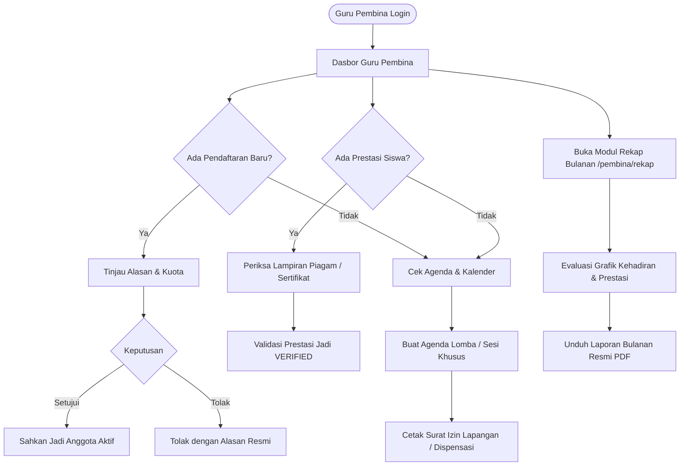

# Analisis & Panduan Fitur Role Pembina - EskulHub SMKN 1 Ciomas

Dokumen ini menyajikan panduan dan analisis mendalam mengenai seluruh kapabilitas, hak akses, alur kerja operasional, serta arsitektur fitur untuk **Role Pembina (Guru Pembina Ekstrakurikuler)** pada platform **EskulHub**.

---

## 1. Ringkasan Eksekutif
Dalam tata kelola kesiswaan SMKN 1 Ciomas, **Role Pembina** bertindak sebagai *supervisor*, verifikator, dan penanggung jawab formal atas satu atau lebih cabang ekstrakurikuler binaannya. Pembina menjembatani kebijakan manajemen sekolah (Wakil Kepala Sekolah Bidang Kesiswaan) dengan kegiatan operasional yang dijalankan siswa. 

Sistem memberikan pembina wewenang formal untuk:
- Mengesahkan penerimaan anggota baru.
- Memantau rekap kehadiran dan disiplin latihan per sesi.
- Memvalidasi piagam dan prestasi kejuaraan siswa agar berstatus *Verified*.
- Mengatur agenda turnamen/kompetisi dan pengajuan dispensasi.
- Menghasilkan laporan bulanan pembinaan resmi dalam format PDF berstandar sekolah.

---

## 2. Rincian Fitur & Kemampuan Role Pembina

### A. Manajemen Ekstrakurikuler Binaan
| Fitur | Deskripsi | Modul / Komponen Terkait |
| :--- | :--- | :--- |
| **Dasbor Kilat Pembina** | Ikhtisar metrik binaan: total ekskul yang diampu, jumlah anggota aktif, pendaftaran baru (*pending*), rata-rata kehadiran %, dan prestasi yang butuh validasi. | `TeacherDashboardPage.tsx` |
| **Katalog Ekskul Binaan** | Melihat dan memantau status operasional ekskul yang dibina (kuota terisi, profil pengurus inti, jadwal mingguan, dan lokasi latihan). | `TeacherDashboardPage.tsx`, `extracurriculars.ts` |
| **Penyesuaian Informasi Profil Ekskul** | Mengawasi deskripsi silabus latihan, target program kerja semester, dan kriteria penerimaan anggota. | `AdminFormEkskulPage.tsx`, `DetailPage.tsx` |

### B. Verifikasi Pendaftaran & Manajemen Anggota
| Fitur | Deskripsi | Modul / Komponen Terkait |
| :--- | :--- | :--- |
| **Penyaringan Registrasi Calon Anggota** | Menerima berkas pengajuan pendaftaran siswa baru, membaca alasan memilih ekskul, pengalaman, dan nomor kontak orang tua/wali. | `TeacherDashboardPage.tsx`, `registrations.ts` |
| **Persetujuan / Penolakan Pendaftaran** | Tombol aksi *Approve* (siswa otomatis berstatus anggota resmi) atau *Reject* dengan lampiran catatan/alasan resmi penolakan (misal: kuota penuh/faktor kesehatan). | `TeacherDashboardPage.tsx` |
| **Buku Induk Anggota Aktif** | Memantau seluruh data siswa yang aktif, kelas, NISN, peran struktural (Ketua/Sekretaris/Anggota), dan tanggal bergabung. | `TeacherDashboardPage.tsx`, `users.ts` |

### C. Pengawasan Presensi & Disiplin Siswa
| Fitur | Deskripsi | Modul / Komponen Terkait |
| :--- | :--- | :--- |
| **Rekapitulasi Kehadiran Sesi Latihan** | Memantau daftar sesi latihan yang telah diselenggarakan oleh pengurus ekskul beserta tingkat persentase absensi. | `TeacherDashboardPage.tsx`, `attendance.ts` |
| **Review Catatan Performa Anggota** | Mengevaluasi catatan per sesi latihan (keaktifan, kedisiplinan, keterlambatan) yang menjadi bobot penilaian portofolio akhir semester. | `StudentAttendanceTab.tsx`, `TeacherDashboardPage.tsx` |
| **Deteksi Siswa Pasif / Menurun** | Melihat metrik persentase kehadiran untuk mengidentifikasi anggota yang jarang hadir agar dapat diberikan pembinaan personal. | `ReportCharts.tsx`, `MonthlyReportPage.tsx` |

### D. Validasi & Pengesahan Prestasi Lomba Siswa
| Fitur | Deskripsi | Modul / Komponen Terkait |
| :--- | :--- | :--- |
| **Verifikasi Piagam & Kejuaraan** | Memeriksa berkas bukti fisik sertifikat/piagam juara yang diunggah siswa. | `TeacherDashboardPage.tsx`, `verifications.ts` |
| **Sematkan Status "Verified" Institusional** | Menandatangani dan mengesahkan prestasi kejuaraan secara digital sehingga prestasi tersebut resmi tercantum di lembar portofolio kesiswaan. | `TeacherDashboardPage.tsx`, `generatePortfolioPdf.ts` |
| **Pencatatan Tingkat Lomba** | Memastikan tingkatan kejuaraan terdata tepat (Tingkat Sekolah, Kecamatan, Kabupaten/Kota Bogor, Provinsi Jawa Barat, hingga Nasional). | `achievements.ts`, `TeacherDashboardPage.tsx` |

### E. Penjadwalan Agenda, Latihan, & Jadwal Lomba
| Fitur | Deskripsi | Modul / Komponen Terkait |
| :--- | :--- | :--- |
| **Manajemen Kalender & Agenda Ekskul** | Menambahkan agenda latihan gabungan, persiapan tanding, pelantikan anggota, atau uji tanding antarsekolah. | `CreateEventPage.tsx`, `CalendarPage.tsx` |
| **Import Jadwal via Excel** | Fasilitas impor jadwal kegiatan massal dari berkas spreadsheet (.xlsx/.xls) dengan validasi otomatis bentrok jam/lapangan. | `ImportEventsPage.tsx`, `ImportExcelModal.tsx` |
| **Penerbitan Surat Dispensasi Lomba** | Pembuatan surat izin dispensasi resmi bagi siswa yang mengikuti turnamen/kejuaraan di luar sekolah untuk diserahkan ke wali kelas/guru piket. | `generateCompetitionDispensationPdf.ts`, `FieldPermitModal.tsx` |
| **Peminjaman Fasilitas & Lapangan** | Pengajuan dan pencetakan surat izin penggunaan lapangan sekolah (lapangan basket, futsal, aula, laboratorium bahasa) ke bagian sarana prasarana. | `generateFieldPermitPdf.ts`, `FieldPermitModal.tsx` |

### F. Rekapitulasi Bulanan & Ekspor PDF Resmi
| Fitur | Deskripsi | Modul / Komponen Terkait |
| :--- | :--- | :--- |
| **Pusat Rekap Bulanan (`/pembina/rekap`)** | Halaman analitik khusus yang mengagregasikan pertumbuhan anggota, rasio kehadiran bulanan, pemanfaatan fasilitas, dan daftar prestasi per bulan. | `MonthlyReportPage.tsx`, `monthlyReportService.ts` |
| **Grafik Visual Interaktif** | Visualisasi data mencakup tren keaktifan mingguan, kapasitas tampung ekskul (*donut chart*), dan histori sesi latihan. | `ReportCharts.tsx` |
| **Generator Laporan Bulanan PDF** | Pencetakan dokumen laporan pembinaan resmi bertanda tangan digital Pembina dan Waka Kesiswaan yang siap diserahkan ke Kepala Sekolah. | `generateMonthlyReportPdf.ts` |

---

## 3. Diagram Alur Kerja Pembina (Supervisor Journey)

---

## 4. Matriks Kewenangan (Pembina vs Siswa vs Pengurus)

| Aksi / Fitur | Siswa | Pengurus | Guru Pembina |
| :--- | :---: | :---: | :---: |
| Mengikuti Kuis Minat Bakat | Ya | Ya | - |
| Mengajukan Pendaftaran Anggota | Ya | - | - |
| Meninjau & Mengesahkan Pendaftaran Baru | - | Tinjauan Awal | **Pemberi Keputusan Formal** |
| Membuka Sesi Presensi & Input Absen | - | **Operator Utama** | Pengawas & Korektor |
| Mengunggah Berkas Piagam Mandiri | Ya | Ya | - |
| Mengesahkan Status Prestasi (*Verified*) | - | - | **Wewenang Mutlak** |
| Menjadwalkan Latihan / Event Sekolah | - | Mengusulkan | **Pemberi Izin / Pembuat** |
| Menerbitkan Izin Lapangan & Dispensasi | - | Pemohon | **Penandatangan & Pengesah** |
| Mengunduh Portofolio Personal | Ya (Milik Sendiri) | Ya (Milik Sendiri) | - |
| Mengunduh Rekap Bulanan Resmi PDF | - | Draft Pengurus | **Laporan Resmi Pembinaan** |

---

## 5. Analisis Nilai Tambah & Efisiensi Supervisi

1. **Akuntabilitas Pembinaan Berbasis Bukti (*Evidence-Based*):**
   - Laporan bulanan pembina tidak lagi dibuat manual dengan mengetik ulang absensi dan daftar juara. Seluruh data teragregasi secara otomatis dari histori aktivitas riil di lapangan.
2. **Standardisasi Dispensasi & Administrasi Kompetisi:**
   - Surat dispensasi lomba dan izin pemakaian lapangan memiliki format standar terpadu dengan nomor surat resmi, logo SMKN 1 Ciomas, dan kop dinas pendidikan, meminimalisir perselisihan penggunaan fasilitas sekolah.
3. **Penyaringan Anggota Objektif:**
   - Pembina dapat memantau kualifikasi pendaftar secara transparan dan menjaga rasio ideal antara kapasitas fasilitas latihan dan jumlah siswa yang dibina.
