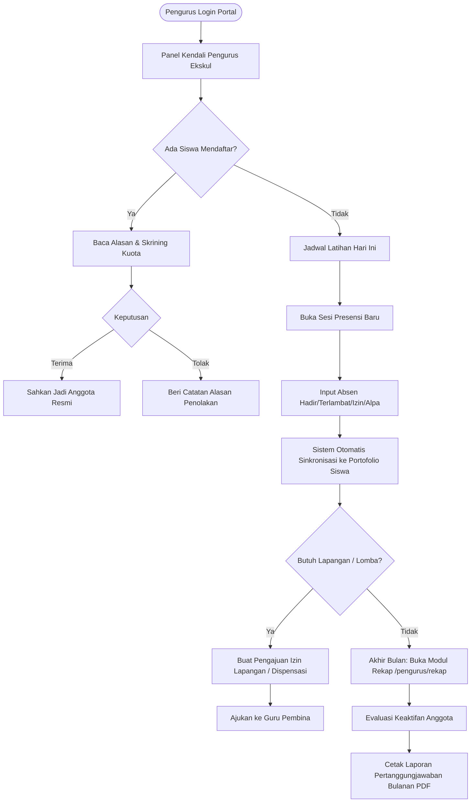

# Analisis & Panduan Fitur Role Pengurus - EskulHub SMKN 1 Ciomas

Dokumen ini menyajikan panduan dan analisis mendalam mengenai seluruh kapabilitas, alur kerja operasional, integrasi tim, serta arsitektur fitur untuk **Role Pengurus (Ketua & Pengurus Ekstrakurikuler Siswa)** pada platform **EskulHub**.

---

## 1. Ringkasan Eksekutif
Dalam struktur organisasi ekstrakurikuler di SMKN 1 Ciomas, **Role Pengurus** adalah siswa yang memegang amanah kepemimpinan (Ketua, Wakil Ketua, Sekretaris, atau Koordinator Divisi). Pengurus berperan sebagai **motor operasional harian** di lapangan yang menjalankan agenda latihan, mencatat kehadiran rekan-rekannya, mendokumentasikan kegiatan, dan mengelola pendaftaran anggota baru.

Platform EskulHub memberikan pengurus alat digital untuk menggantikan pencatatan manual berbasis kertas (seperti buku absensi fisik atau formulir pendaftaran fotokopi) menjadi alur kerja digital yang rapi, transparan, dan terhubung langsung ke pembina serta portofolio resmi siswa.

---

## 2. Rincian Fitur & Kemampuan Role Pengurus

### A. Dasbor Operasional Ekskul
| Fitur | Deskripsi | Modul / Komponen Terkait |
| :--- | :--- | :--- |
| **Panel Kendali Ekskul Terpusat** | Menampilkan identitas ekskul yang dikelola, nama ketua & pembina, ringkasan anggota aktif, jumlah pendaftar baru yang perlu ditinjau, dan sesi presensi terbaru. | `PengurusDashboardPage.tsx` |
| **Pusat Aksi Cepat (*Quick Actions*)** | Akses langsung 1-klik untuk membuka sesi presensi baru, meninjau berkas pendaftaran, atau mengecek rekap bulanan ekskul. | `PengurusDashboardPage.tsx` |

### B. Pencatatan Presensi Digital Sesi Latihan
| Fitur | Deskripsi | Modul / Komponen Terkait |
| :--- | :--- | :--- |
| **Pembukaan Sesi Latihan Baru** | Membuat lembar absensi latihan baru dengan parameter: Judul Materi Sesi, Tanggal, Jam Mulai - Selesai, Lokasi Lapangan, dan Catatan Materi. | `PengurusAttendancePage.tsx`, `attendance.ts` |
| **Input Kehadiran Anggota *Real-Time*** | Mengubah status presensi per siswa secara instan: `Hadir` (Present), `Terlambat` (Late), `Izin / Sakit` (Excused), atau `Alpa` (Absent). | `PengurusAttendancePage.tsx` |
| **Otomatisasi Kalkulasi Presensi** | Setiap perubahan status absensi yang disimpan pengurus langsung memperbarui persentase kehadiran (*Attendance Rate*) pada lembar portofolio siswa yang bersangkutan. | `attendance.ts`, `StudentOverviewTab.tsx` |
| **Riwayat & Arsip Sesi Latihan** | Memilih dan meninjau kembali seluruh riwayat sesi latihan sebelumnya untuk evaluasi keaktifan anggota. | `PengurusAttendancePage.tsx` |

### C. Verifikasi & Skrining Pendaftaran Calon Anggota
| Fitur | Deskripsi | Modul / Komponen Terkait |
| :--- | :--- | :--- |
| **Penyaringan Berkas Pendaftaran** | Memeriksa data siswa yang mendaftar ke ekskul: membaca alasan pendaftaran, pengalaman lomba/organisasi, komitmen jadwal, dan data kontak. | `PengurusDashboardPage.tsx`, `registrations.ts` |
| **Modal Telaah & Rekomendasi Pendaftaran** | Menyetujui (*Approve*) atau menolak (*Reject*) calon anggota dilengkapi modal catatan verifikasi resmi yang langsung dikirimkan ke dashboard siswa. | `PengurusDashboardPage.tsx` |
| **Kontrol Kapasitas & Kuota Anggota** | Memantau batas kuota anggota agar penerimaan siswa tidak melebihi rasio ideal pembinaan. | `extracurriculars.ts`, `PengurusDashboardPage.tsx` |

### D. Manajemen Buku Induk Anggota Ekskul
| Fitur | Deskripsi | Modul / Komponen Terkait |
| :--- | :--- | :--- |
| **Daftar Anggota Aktif** | Memantau seluruh siswa yang terdaftar resmi di ekskul, tingkatan kelas, nomor induk (NISN), serta jabatan dalam tim. | `PengurusDashboardPage.tsx`, `users.ts` |
| **Monitoring Keaktifan Anggota** | Mengidentifikasi anggota yang rajin hadir maupun yang memiliki riwayat izin/alpa berulang untuk dilaporkan kepada guru pembina. | `PengurusDashboardPage.tsx`, `attendance.ts` |

### E. Dokumentasi Kegiatan & Pencatatan Prestasi Tim
| Fitur | Deskripsi | Modul / Komponen Terkait |
| :--- | :--- | :--- |
| **Dokumentasi Kegiatan & Latihan** | Mengarsipkan catatan dan foto dokumentasi kegiatan latihan rutin, latih tanding (sparing), maupun musyawarah anggota. | `PengurusDashboardPage.tsx` |
| **Pencatatan Prestasi & Medali Tim** | Menginventarisasi kejuaraan atau turnamen yang dimenangkan oleh perwakilan ekskul untuk diajukan pengesahannya ke guru pembina. | `PengurusDashboardPage.tsx`, `achievements.ts` |

### F. Pengajuan Peminjaman Lapangan & Surat Izin
| Fitur | Deskripsi | Modul / Komponen Terkait |
| :--- | :--- | :--- |
| **Permohonan Izin Pemakaian Lapangan** | Menyiapkan permohonan peminjaman fasilitas sekolah (lapangan basket/futsal, aula, sound system, lab) kepada wakil sarana prasarana. | `FieldPermitModal.tsx`, `generateFieldPermitPdf.ts` |
| **Pengajuan Dispensasi Turnamen** | Menyusun draf daftar nama atlet/anggota yang akan berlaga di kejuaraan untuk diterbitkan surat dispensasi resminya oleh pembina. | `generateCompetitionDispensationPdf.ts` |

### G. Laporan Bulanan Operasional Pengurus
| Fitur | Deskripsi | Modul / Komponen Terkait |
| :--- | :--- | :--- |
| **Rekapitulasi Bulanan Pengurus (`/pengurus/rekap`)** | Meninjau laporan konsolidasi bulanan kegiatan ekskul mencakup total sesi latihan, rata-rata kehadiran anggota, dan rekap pendaftar baru. | `MonthlyReportPage.tsx`, `ReportCharts.tsx` |
| **Ekspor PDF Laporan Kegiatan Pengurus** | Mencetak berkas PDF laporan pertanggungjawaban bulanan pengurus untuk diserahkan dalam rapat rutin bersama guru pembina. | `generateMonthlyReportPdf.ts` |

---

## 3. Diagram Alur Kerja Pengurus (Officer Journey)

---

## 4. Matriks Kolaborasi Pengurus dengan Guru Pembina

| Tanggung Jawab Operasional | Pengurus Siswa | Guru Pembina |
| :--- | :---: | :---: |
| Menyusun Jadwal Sesi Latihan Rutin Mingguan | **Perencana Lapangan** | Penyetuju & Pengawas |
| Mengisi Presensi & Mencatat Absensi per Sesi | **Pelaksana Langsung** | Pengawas Mutu & Validasi |
| Skrining Awal Formulir Pendaftaran Siswa Baru | **Penyaring Awal** | Pengesah Resmi |
| Mengusulkan Anggota untuk Lomba / Kejuaraan | **Pemilih Tim / Skuad** | Penyetuju & Pendamping |
| Menandatangani Portofolio & Piagam Resmi | - | **Tanda Tangan Formal** |
| Menyiapkan Berkas Laporan Pertanggungjawaban | **Penyusun Draf Bulanan** | Pengesah Laporan ke Sekolah |

---

## 5. Analisis Dampak & Pembinaan Karakter Kepemimpinan (*Student Leadership*)

1. **Pengembangan Kepemimpinan & Manajemen Nyata:**
   - Platform EskulHub memberikan pengalaman tata kelola organisasi modern bagi siswa pengurus, mulai dari pengelolaan kuota, pencatatan absensi yang transparan, hingga penyusunan laporan kegiatan berbasis data.
2. **Efisiensi Waktu & Transparansi Lapangan:**
   - Pengurus tidak lagi disibukkan dengan pencarian buku absensi yang sering tertinggal atau basah di lapangan. Presensi dapat langsung diisi melalui ponsel pintar (*mobile web*) saat sesi latihan berlangsung.
3. **Mencegah Manipulasi & Favoritisme:**
   - Status pendaftaran dan presensi tersimpan transparan di sistem sekolah, meminimalisir potensi titipan anggota atau absensi fiktif.
