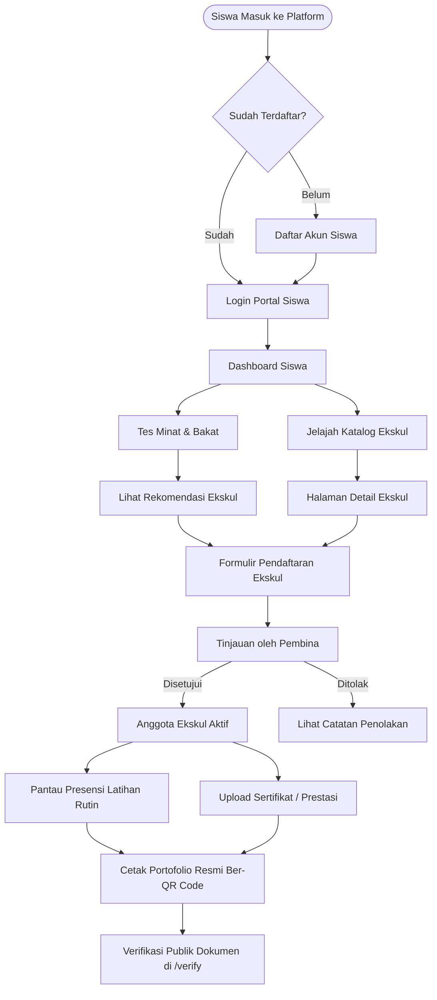

# Analisis & Panduan Fitur Role Siswa - EskulHub SMKN 1 Ciomas

Dokumen ini menyajikan rincian menyeluruh mengenai kapabilitas, alur kerja (*user journey*), struktur teknis, serta analisis dampak dari fitur-fitur yang dapat diakses oleh pengguna dengan **Role Siswa** pada platform **EskulHub**.

---

## 1. Ringkasan Eksekutif
Dalam ekosistem EskulHub, **Role Siswa** dirancang sebagai pusat partisipasi kegiatan non-akademik di SMKN 1 Ciomas. Siswa tidak hanya sekadar mendaftar kegiatan, melainkan memiliki rekam jejak digital (*digital footprint*) yang tervalidasi secara institusional—mulai dari pencocokan minat, presensi latihan rutin, hingga sertifikasi prestasi yang dapat dikonversi menjadi lembar portofolio kesiswaan resmi ber-QR Code.

---

## 2. Rincian Fitur & Kemampuan Role Siswa

### A. Eksplorasi & Pencocokan Minat
| Fitur | Deskripsi | Modul / Komponen Terkait |
| :--- | :--- | :--- |
| **Katalog & Jelajah Ekskul** | Penjelajahan seluruh ekskul dengan pencarian real-time, filter kategori, status kuota pendaftaran, jadwal, lokasi, dan profil guru pembina. | `CatalogPage.tsx`, `StudentBrowseTab.tsx` |
| **Detail Ekskul Kontekstual** | Menampilkan silabus kegiatan, foto aktivitas tim, kapasitas anggota, dan tombol kembali cerdas (*contextual routing* kembali ke dashboard jika diakses dari dalam portal). | `DetailPage.tsx`, `DetailHero.tsx`, `DetailContent.tsx` |
| **Tes Minat & Bakat Interaktif** | Kuesioner psikometri 5 langkah untuk mendeteksi preferensi bakat (olahraga, kepemimpinan, sains/teknologi, seni, keagamaan) dengan rekomendasi cerdas dan persentase skor kecocokan. | `OnboardingQuestionnairePage.tsx`, `OnboardingQuestionnaireModal.tsx` |

### B. Pendaftaran & Status Keanggotaan
| Fitur | Deskripsi | Modul / Komponen Terkait |
| :--- | :--- | :--- |
| **Pendaftaran Mandiri** | Pengisian formulir pendaftaran ekskul dengan validasi kuota otomatis untuk mencegah kelebihan daya tampung anggota. | `RegisterEkskulPage.tsx`, `DetailRegisterModal.tsx` |
| **Pemantauan Status Registrasi** | Melihat riwayat pengajuan registrasi dengan status *real-time* (`Menunggu Review`, `Diterima / Aktif`, `Ditolak`) lengkap dengan umpan balik/catatan pembina. | `StudentRegistrationsTab.tsx` |
| **Manajemen Ekskul Aktif** | Melihat kartu keanggotaan aktif siswa, peran dalam organisasi (Anggota / Pengurus Inti), serta jadwal latihan mingguan. | `StudentOverviewTab.tsx` |

### C. Presensi & Disiplin Latihan
| Fitur | Deskripsi | Modul / Komponen Terkait |
| :--- | :--- | :--- |
| **Statistik Kehadiran** | Rekapitulasi metrik disiplin siswa: persentase kehadiran (*attendance rate*), jumlah sesi hadir, terlambat, izin/sakit, dan alpa. | `StudentAttendancePage.tsx`, `StudentAttendanceTab.tsx` |
| **Filter Multi-Kriteria & Kalender** | Memfilter riwayat presensi berdasarkan ekskul tertentu, status absensi, dan **Custom Date Picker Popover** (filter kalender interaktif). | `DatePickerPopover.tsx`, `calendarUtils.ts` |
| **Catatan Evaluasi Pembina** | Membaca catatan khusus dari pembina di setiap sesi latihan mengenai performa dan perkembangan siswa. | `StudentAttendanceTab.tsx` |

### D. Dokumen, Prestasi, & Portofolio Resmi
| Fitur | Deskripsi | Modul / Komponen Terkait |
| :--- | :--- | :--- |
| **Pencatatan Rekam Prestasi** | Melihat rekam jejak juara lomba/kejuaraan beserta tingkatan (Sekolah, Kota/Kabupaten, Provinsi, Nasional) dan status verifikasi kesiswaan. | `StudentAchievementsTab.tsx` |
| **Unggah Dokumen Sertifikat** | Mengunggah piagam/sertifikat mandiri sebagai arsip digital kesiswaan dengan pratinjau dokumen dan pencatatan nomor piagam resmi. | `StudentUploadDocumentPage.tsx`, `StudentDocumentsTab.tsx` |
| **Generator Portofolio PDF Resmi** | Menghasilkan berkas PDF A4 siap cetak lengkap dengan kop sekolah, Cabang Dinas Wilayah I, QR Code validasi, rekap presensi, dan tanda tangan digital kesiswaan. | `generatePortfolioPdf.ts`, `StudentPortfolioTab.tsx` |
| **Verifikasi Portofolio Mandiri** | Melakukan verifikasi keaslian dokumen portofolio atau sertifikat melalui form verifikasi publik atau pemindaian QR Code. | `VerificationPage.tsx` |

---

## 3. Diagram Alur Pengguna (User Journey)

---

## 4. Analisis Nilai Tambah & Keunggulan Sistem

### 1. Solusi Konkret Terhadap Masalah Administrasi Sekolah
- **Sebelum EskulHub:** Penilaian ekskul sering kali bersifat formalitas di akhir semester pada lembar raport cetak, piagam sering hilang atau tercecer, dan pembuktian keikutsertaan ekskul rawan dipalsukan.
- **Dengan EskulHub:** Seluruh kehadiran tercatat per sesi dengan persentase otomatis. Portofolio dilengkapi dengan QR Code kriptografis yang membuktikan keaslian dokumen ketika dilampirkan siswa untuk SNBP, pendaftaran beasiswa, atau melamar kerja.

### 2. Desain Antarmuka Modern & Responsif
- **Glassmorphism & Clean Typography:** Komponen kartu galeri akordeon dan popover kalender dibuat modern tanpa menutupi konten visual utama.
- **Contextual Fallback Visual:** Seluruh kartu ekskul dilengkapi pelindung gambar kontekstual (`imageUtils.ts`) sehingga kegagalan koneksi atau CDN tidak akan menampilkan placeholder rusak atau gambar yang tidak relevan.
- **Mobile-First UX:** Tata letak disesuaikan untuk layar smartphone dengan navigasi drawer bersih dan aksi sekunder teratur.

### 3. Keamanan Data & Validasi Multi-Tier
- Siswa hanya memiliki izin baca (*read*) terhadap data presensi yang telah disahkan pembina/pengurus.
- Siswa tidak dapat memanipulasi persentase kehadiran atau status keanggotaan sendiri.
- Setiap sertifikat yang diunggah harus melalui tahap verifikasi admin/kesiswaan sebelum statusnya berubah menjadi *Verified*.

---

## 5. Peluang Pengembangan Fitur (Feature Roadmap)

1. **Pengajuan Izin Latihan Mandiri (*Self-Service Absence Request*):**
   - Mengizinkan siswa mengajukan izin latihan sakit/keperluan keluarga dari dashboard dengan melampirkan foto surat izin sebelum sesi dimulai.
2. **Notifikasi Jadwal & Pengingat Sesi (*Push Notifications / Webhook*):**
   - Integrasi pengingat otomatis ke siswa jika ada sesi latihan rutin besok sore atau ada pengumuman mendesak dari pembina.
3. **Filter Portofolio Multi-Semester:**
   - Memungkinkan siswa kelas XII memilih apakah ingin mencetak portofolio satu semester terakhir atau komprehensif 3 tahun selama bersekolah di SMKN 1 Ciomas.

